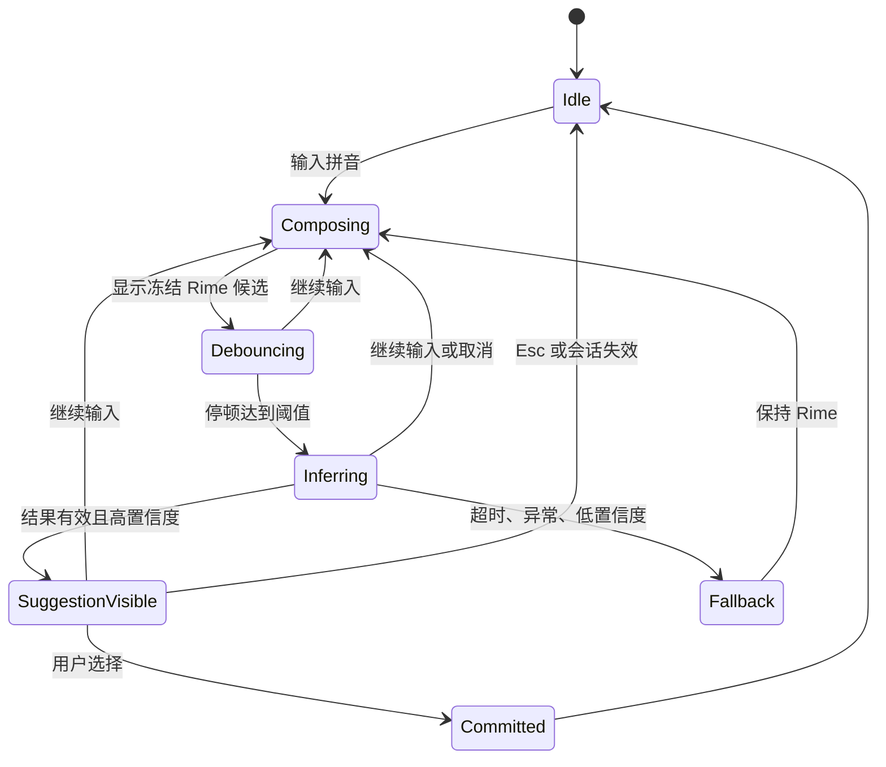
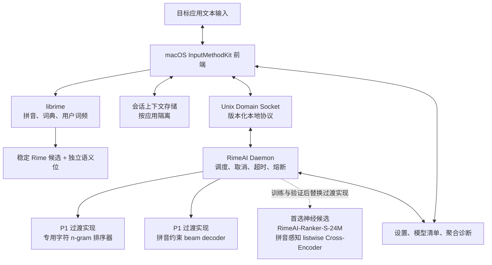

# RimeAI 本地语义输入引擎最终设计

> 基于 Rime、设备端语义排序与受约束整句解码的隐私型中文输入系统

| 项目 | 内容 |
|---|---|
| 文档版本 | 1.0 |
| 文档日期 | 2026-08-13 |
| 文档状态 | `ACCEPTED TARGET STATE`，其中交付状态按本章证据表单独标记 |
| 产品代号 | RimeAI；Phoenix / ASIE 仅作为历史候选名称 |
| 首发平台 | macOS Apple Silicon |
| 首发用户 | Rime 高级用户、开发者、技术写作者、隐私敏感专业用户 |
| 核心范围 | 普通话全拼、简体中文、Rime 候选、上下文重排、拼音约束整句建议、本地隐私控制 |
| 文档权威 | 本文件是键盘语义输入主线的产品与技术设计权威 |

> **2026-08-14 macOS 可选云增强补充决策（覆盖下文冲突条款）**：默认产品和
> 本地 daemon 仍保持本地优先、永久 Offline Lock。用户在隐私控制中心主动
> 保存 API Key 后，可另行启用独立的阿里云 Qwen broker。该路径只允许固定
> endpoint 与固定模型，从最多 50 个由 Rime 证明的精确/模糊候选中返回一个
> candidate ID，不能自由生成上屏文本；总截止时间 800ms，结果只占一个显式
> 建议位。配置 Key 后，RimeAI 成功上屏文本会跨应用明文、无限期保存在本机，
> 用于 600 字近期上下文和最多 8 条 FTS/HNSW 检索片段；用户可导出或永久清除。
> macOS Secure Event Input 会自动阻断云推理与历史写入；应用级本地 AI 策略、
> 严格/标准/智能上下文档位不约束这一显式云功能。移除 Key 会停用云端但保留
> 历史，清除历史是独立操作。下文“无云端推理”“不保存跨应用历史”以及
> “所有产品进程 Offline Lock”等表述，仅适用于默认本地路径或历史方案。

## 0. 文档边界与证据等级

本文件把相关讨论中已经接受的产品判断、产品能力、交互约束、模型路线、
系统架构、数据训练、评测、隐私、平台、商业化和路线图合并为一份可执行设计。
它不是市场宣传，也不把目标设计写成已经交付。

仓库中的 [PRD.md](PRD.md) 保留更早阶段的需求拆解和一条独立语音提案。
语音并不在本次聊天确认的键盘语义输入基线中，因此必须作为独立工作流评审，
不得借本文件自动进入 MVP。该独立工作流的设计草案见
[docs/VOICE_INPUT_DESIGN.md](docs/VOICE_INPUT_DESIGN.md) 与本文件第 25 章
摘要。若两份文档在键盘语义输入主线上冲突，以本文件为准。

本文使用四种证据等级：

| 等级 | 含义 | 可对外表述 |
|---|---|---|
| `ACCEPTED TARGET STATE` | 已接受的产品或架构决策 | 可以说“设计为” |
| `CHECKED IMPLEMENTATION` | 当前代码和本轮测试已证明 | 可以说“已实现并通过指定检查” |
| `LOCAL EXPERIMENT` | 固定环境中的离线或原型结果 | 必须附硬件、数据和边界 |
| `EXTERNAL ACCEPTANCE` | 签名、公证、真实应用兼容、分发和用户验证 | 只有外部证据完成后才能说“可发布” |

### 0.1 当前交付快照

截至 2026-08-14，本仓库的状态是：

| 能力 | 证据等级 | 状态 |
|---|---|---|
| 真实 librime Top-20 候选采集 | `LOCAL EXPERIMENT` | 已实现，参考版本为 librime 1.17.0 |
| 10,000 条通用/开发冻结集 | `LOCAL EXPERIMENT` | 已完成文档级隔离的 80/10/10 切分 |
| 专用字符 n-gram 候选排序 | `LOCAL EXPERIMENT` | conditional Top-1 相对提升 5.51%，P95 1.576ms |
| 24M INT8 ONNX 神经+n-gram 融合排序 | `LOCAL EXPERIMENT` | 0.90 门下 conditional Top-1 94.5501%，CPU P95 42.70ms，已接入 macOS daemon |
| 拼音约束整句 beam decoder | `LOCAL EXPERIMENT` | 整句准确率相对提升 46.46%，P95 40.524ms |
| 11–30 字扩展长句 | `LOCAL EXPERIMENT` | 0.97 阈值相对提升 38.4617%，P95 14.71ms |
| GTE multilingual reranker 306M | `LOCAL EXPERIMENT` | 已否决，不满足质量和延迟 |
| Qwen2.5-0.5B-Instruct | `LOCAL EXPERIMENT` | 已否决，不满足拼音正确性和实时预算 |
| macOS InputMethodKit 输入法源码原型 | `CHECKED IMPLEMENTATION` | 已实现 Rime 候选、独立语义位、100ms debounce、取消和隐私控制 |
| 用户级 Unix Domain Socket daemon | `CHECKED IMPLEMENTATION` | 已实现协议握手、同 UID 检查、超时、取消、熔断与离线网络守卫 |
| 可选 Qwen 云 broker | `CHECKED IMPLEMENTATION` | cloud.env 文件凭据（0600）、独立同 UID UDS、固定模型、candidate-ID-only 合同、800ms/stale/Secure 门已实现；真实 API 效果和网络时延待外部验收 |
| 云候选与长期历史 | `CHECKED IMPLEMENTATION` | Top-30 精确候选加受限错拼扩展至最多 50 条；明文 SQLite WAL、FTS、512 维 embedding/HNSW、导出和永久清除已实现 |
| 隐私控制与数据生命周期 | `CHECKED IMPLEMENTATION` | 三档上下文、应用策略、无原文诊断、制品哈希、可恢复清理已实现 |
| 用户级 daemon 生命周期 | `CHECKED IMPLEMENTATION` | 自包含 ONNX release、LaunchAgent、版本化升级/回滚、0600 UDS、无 INET 描述符已验证 |
| 受控 macOS librime | `CHECKED IMPLEMENTATION` | 固定源码、静态 arm64 XCFramework、macOS 14、无 Homebrew 运行依赖 |
| Developer ID Release 制品 | `CHECKED IMPLEMENTATION` | 输入法成对 ZIP（同 Team/version 的 nested voice helper）与 daemon 归档均完成 hardened-runtime 签名、时间戳和哈希验证；公证仍是外部门 |
| 语音听写链路与 V0 评测工具（独立工作流） | `CHECKED IMPLEMENTATION` | 9 消息 V2 严格协议、客户端/服务端状态机、Coordinator、私有 UDS、Release 认证 NSXPC、helper、按住说话浮层与设置生命周期均已接线并有自动化覆盖；只有另行明示开启默认关闭的会话热词策略后，当前焦点会话的已确认 Rime commit 才会以有界摘要快照传入声明支持热词的引擎。sherpa-onnx 1.13.6 + ORT 1.27.1 静态 runtime、真实 C backend、冻结 corpus loader、评分器与产品模型 manifest/store 基础层已实现。当前 Apple Speech 仍是 probe-only；production catalog 因模型权利/来源未完成而为空，正式授权录音、真实 TCC/设备、运行态隐私、公证和清洁机结果待外部验收，见 `docs/VOICE_INPUT_DESIGN.md`、`docs/VOICE_EVAL_FORMAT.md` 与 `docs/VOICE_ASR_ARTIFACT.md` |
| 自动测试 | `CHECKED IMPLEMENTATION` | Swift 47 passed；云 broker/evaluation/index 新增 Python 测试通过，完整命令与沙箱限制见 `docs/CLOUD_INPUT_IMPLEMENTATION.md` |
| Apple Development 签名构建 | `CHECKED IMPLEMENTATION` | codesign 通过；保留为本地开发路径 |
| Developer ID hardened-runtime 签名 | `CHECKED IMPLEMENTATION` | 主 App、内嵌 librime 与独立签名语音 Helper 深度验证通过，并带 Apple 安全时间戳 |
| 安装、升级、回滚、卸载脚本 | `CHECKED IMPLEMENTATION` | v1→v3、v3→v1、再升级 v5 真实验证；卸载为可恢复移入废纸篓，Rime 数据默认保留 |
| 真实应用完整输入路径 | `EXTERNAL ACCEPTANCE` | 未完成本轮记录化验证 |
| 公证与系统输入源信任 | `EXTERNAL ACCEPTANCE` | 未完成；当前 Developer ID bundle 因未公证被 spctl 拒绝 |
| 公开分发许可证 | `EXTERNAL ACCEPTANCE` | 未完成，当前冻结制品仅供内部验证 |

详细 P0 哈希、硬件与指标见
[docs/P0_EVIDENCE.md](docs/P0_EVIDENCE.md)，神经与扩展长句结果见
[docs/P3_NEURAL_RANKER_EVIDENCE.md](docs/P3_NEURAL_RANKER_EVIDENCE.md)。macOS
输入法已改用受控静态 librime，daemon 已改用自包含 INT8 ONNX Runtime；两者
均有 Developer ID 签名发布制品。公开发布仍受 Apple 公证凭据、干净机器与
宿主矩阵、系统级抓包、最低硬件以及许可证法律放行约束。详见
[docs/P1_IMPLEMENTATION_EVIDENCE.md](docs/P1_IMPLEMENTATION_EVIDENCE.md)。

## 1. 执行摘要

### 1.1 一句话定义

RimeAI 是一款基于 Rime 的本地语义中文输入引擎：

> Rime 负责确定性的拼音解析和候选生成，本地专用模型负责上下文重排和受约束
> 整句恢复；原始按键、组合串和上下文默认不离开设备。

### 1.2 核心判断

不让通用自回归聊天模型接管输入法。正确的主链路是：

```text
键盘事件
  -> Rime 拼音切分、词典、用户词频
  -> 同步显示稳定候选
  -> 专用轻量排序器异步判断上下文
  -> 必要时提供一条受拼音约束的整句建议
  -> 用户主动选择后上屏
```

这一设计保留四个不可妥协的性质：

1. 模型未加载、崩溃、超时或被隐私策略禁止时，纯 Rime 仍可输入。
2. 已显示的数字候选不因异步结果跳动。
3. 自由生成不进入同步按键链路，也不自动替换用户文字。
4. “本地”必须由进程、IPC、日志、存储和网络策略共同证明。

### 1.3 产品不是“输入法里的聊天机器人”

RimeAI 的核心不是聊天、知识问答或长文生成，而是
`Context-aware Candidate Ranking`：

```text
上下文 + 拼音 + Rime 候选
              |
              v
       语义候选排序层
              |
              v
      更符合当前语境的候选
```

长期形态是可复用的 `Semantic Candidate Engine`。Rime 输入法是第一个且最
重要的宿主，未来可评估编辑器、终端或其他输入系统，但这些扩展不能稀释首版。

### 1.4 综合预研评估

相关讨论形成的初始判断如下。分数用于排序风险，不是已经验证的市场结论：

| 维度 | 初始评估 | 当前修正 |
|---|---:|---|
| 技术可行性 | 8/10 | P0 已证明专用排序和受约束整句解码可行 |
| 产品差异化 | 8/10 | 仍成立，但公开产品能力正在快速演进 |
| macOS 可行性 | 9/10 | 源码原型和构建已存在，发行工程仍未完成 |
| Windows 可行性 | 7/10 | TSF、签名和兼容矩阵带来较高成本 |
| Android 可行性 | 7/10 | 需要移动专用模型和完整触控键盘 |
| iOS 可行性 | 4/10 | 扩展内存与生命周期要求更小的专用模型 |
| 通用自回归 LLM 直接接入 | 6/10 | 未通过实时输入门，且不属于最终模型选择 |
| 专用模型长期潜力 | 9/10 | 是主要研发方向，但仍需神经模型实证 |
| MVP 开发难度 | 中高 | 输入法兼容、发布和隐私证据是主要成本 |
| 消费商业化潜力 | 中等 | 更适合买断或模型包，不适合强制订阅 |
| 企业与开源潜力 | 较高 | 术语、离线部署和可审计性更有价值 |

## 2. 愿景、目标与非目标

### 2.1 愿景

让用户在不上传正在输入内容的前提下，获得能够理解当前语境的中文候选；
让隐私、准确性、专业术语和可定制性成为同一套系统的组成部分。

### 2.2 产品目标

1. 降低同音词、长拼音串和专业术语场景中的选词、翻页与回删。
2. 让 Rime 用户无须放弃已有 schema、词典、词频和离线工作方式。
3. 在输入法可接受的延迟内完成语义决策，而不是追求聊天吞吐量。
4. 给用户明确的上下文范围、应用级开关、数据查看与清除能力。
5. 用固定数据集、固定 Rime 配置和固定硬件报告效果，不靠主观演示。
6. 建立可替换的模型与运行时边界，不把产品绑定到某个模型名称或参数规模。

### 2.3 非目标

首版不做：

- 云端同步、多设备同步或强制账号。
- 云端推理、云端个性化或静默遥测。
- 聊天机器人、知识问答、Agent 工具调用。
- 语音输入、手写输入、表情包或皮肤商城。
- 自动生成长文、自动替用户发送或无确认改写。
- 默认读取剪贴板、完整文档或跨应用历史。
- iOS、Android、Windows、Linux 同步首发。
- 复杂模型市场和任意第三方代码插件。

语音、润色、翻译、续写和团队训练都是后续可选工作流，必须有独立质量门和
隐私合同。

### 2.4 名称与市场表达

讨论中过的名称包括：

- Rime Local AI。
- RimeMind。
- 知韵输入法。
- 隐墨输入法。
- 灵犀输入。
- Project Phoenix / AI Semantic Input Engine。

当前仓库统一使用 `RimeAI`，避免在完成商标、域名和用户研究前更换品牌。
技术类别可称为“本地语义输入引擎”或 `Semantic Input Engine`。

不把模型参数规模写进主卖点。推荐表达是：

> 它理解你正在写什么，但不需要把你写的内容发送给任何人。

对外发布时还必须把“发送给任何人”限定为产品正常输入链路，并链接威胁模型，
不能掩盖操作系统、宿主应用和本机恶意软件的边界。

## 3. 用户与问题

### 3.1 首发用户

- 已使用鼠须管、Rime 或高度自定义输入方案的 Apple Silicon Mac 用户。
- 经常写技术文档、需求、邮件、代码评审和命令说明的开发者。
- 律师、医生、研究人员等隐私敏感专业用户，但首版只评测通用和软件开发领域。
- 有大量产品名、库名、客户名和固定术语的专业写作者。
- 愿意安装本地组件、理解模型资源开销并参与开发者预览的高级用户。

### 3.2 首版不优先服务

- 以移动社交、皮肤、表情包、热词运营为主的大众用户。
- 强依赖语音、手写或云剪贴板的用户。
- 要求所有设备无感同步的用户。
- 期待输入法直接代写整篇内容的用户。

### 3.3 核心问题

Rime 的确定性、可配置和离线能力很强，但仅依赖拼音切分、词频和传统语言模型
时，仍难稳定解决：

1. **同音消歧**：`suoyin` 在数据库上下文中应优先“索引”。
2. **长句恢复**：连续拼音需要跨词切分、纠错和标点判断。
3. **专业低频词**：`rongqibianpai` 应得到“容器编排”。
4. **中英文混输**：`zhegeAPIxuyaozengjiatimeoutpeizhi` 应得到
   “这个API需要增加timeout配置”。组合串内没有空格；Space 始终表示选择候选
   并上屏，不能作为中英文边界。
5. **用户固定表达**：词频能记住词，未必能理解当前句子的语义。
6. **隐私冲突**：云端 AI 可能有更强语义能力，但输入法接触的内容过于敏感。

用户真正需要的是：

> 在不牺牲 Rime 稳定性、输入速度和本地隐私的前提下，更快选中符合当前语境
> 的文字。

## 4. 市场与竞争位置

### 4.1 市场分类

公开产品大致分为五类：

| 类别 | 代表 | 已公开能力 | 与 RimeAI 的差异 |
|---|---|---|---|
| 传统中文输入法 | 搜狗、百度、微信输入法等 | 联网词库、预测、AI 改写或问答 | 数据边界和实现不可等同于本地 Rime 语义排序 |
| 移动预测键盘 | SwiftKey、Gboard | 下一词预测、写作工具、语气改写 | 多数能力发生在已输入文本或移动键盘层 |
| 系统写作工具 | Apple Writing Tools | 校对、改写、摘要、系统级入口 | 不是拼音候选生成与 Rime Top-K 重排 |
| Rime 生态 | librime、Squirrel、Weasel、Trime 等 | 跨平台输入引擎、词典、schema、插件 | 官方公开能力不等于已产品化的本地语义候选层 |
| 个人实验 | Rime 调用 API/Ollama、键盘修复工具 | 命令式生成、翻译、改写 | 通常不承担毫秒级稳定候选排序 |

Microsoft 官方把 SwiftKey Tone 描述为用户触发的文本改写；Apple Writing Tools
提供校对、改写和摘要；Google 也提供可由用户接受的 writing tools。它们证明
“AI 辅助输入”已经是竞争方向，但不能据此推断其内部候选排序架构。

截至本文核验的公开资料，没有找到一个能够同时证明以下全部条件的成熟产品：

```text
Rime 候选生成
+ 设备端语义重排
+ 上下文受控
+ 候选位置稳定
+ 可验证零网络模式
```

这是一项基于公开资料的市场假设，不是对所有闭源实现的“绝对不存在”证明。
产品立项仍必须依赖自身效果和用户价值，不应只依赖竞品空白。

### 4.2 差异化

RimeAI 的差异化顺序是：

1. **语义候选层**：直接减少选词成本，而不是在输入后附加聊天功能。
2. **Rime 兼容**：保留成熟的拼音、词典、schema 与用户资产。
3. **本地可审计**：模型、IPC、日志和网络边界可检查。
4. **专业词汇**：词典、领域数据和语义排序结合。
5. **故障可退化**：AI 不是输入可用性的单点。

### 4.3 护城河

“Rime + 某个开源大模型”很容易复制。长期护城河来自：

- 获得合法授权的输入法专用排序数据。
- 针对难负样本训练的专用候选模型。
- 极低延迟、可取消、不会跳动的推理管线。
- 跨应用 InputMethodKit 兼容性和发布工程。
- 可解释的用户词库、领域词库和本地个性化。
- 可被验证的隐私和数据生命周期。
- IMEBench、回归集和真实用户反馈闭环。

## 5. 产品能力

### 5.1 Rime 基础输入与兜底

- Rime 负责普通话全拼、简体中文的拼音解析、词典匹配和候选生成。
- 保留用户词典、词频学习、简繁切换和自定义 schema 的纯 Rime 能力。
- AI 只对经过验证的 schema 提供效果承诺。
- 任何模型故障只隐藏语义建议，不影响主候选。

### 5.2 上下文候选重排

输入合同：

```json
{
  "context": "这个服务使用 PostgreSQL 作为",
  "pinyin": "zhushujuku",
  "candidates": ["主数据库", "住数据库", "著数据库", "主数据哭"]
}
```

排序器输出候选身份、排序或受约束的首选和置信度。MVP 不改变已经显示的
Rime 数字候选，而是在独立语义位显示结果。用户按下 `Tab` 时可以主动采用
当前组合中仍然有效的语义结果；`Space` 始终提交 Rime 第一候选。完整候选少于
2 个时返回 `insufficient_candidates`，不得报告 `same_top_candidate`。当前运行时
整句建议展示阈值为 0.60；模型比较后仍选择第一项时，语义位显示具体文本和
“与 Rime 首选一致”，不再只显示抽象状态。

### 5.3 拼音约束整句建议

对较长组合串，系统可以给出一条整句建议：

```text
输入: womendajiangzhegegongnengfangdaoxiazhou
建议: 我们打算将这个功能放到下周。
```

约束：

- 简体拼音组合从 2 个字符起触发；单字符、繁体模式或策略禁止时不触发。
- 每个中文字符必须能由冻结的 Rime 拼音词典证明与输入拼音兼容。
- 本地生成文本必须符合当前简繁设置；字形不一致时显示不可选的拒绝原因。
- 最多一条，默认不超过 30 个汉字，不含解释或换行。
- 明确显示语义标记，用户主动选择后才上屏。
- 超过 30 字或候选未覆盖完整拼音时必须显式弃权，不得展示截断的半句话。
- 不能把“读起来更自然”当作突破拼音约束的理由。

当前质量门包含 4,000 条 6–10 字冻结数据和 1,600 条 11–30 字扩展冻结数据。
扩展 test 在 0.97 产品阈值下相对 Rime 首选提升 38.4617%，P95 14.71ms。
现用 6–30 字 test 明细按外层 0.60 重算为整句准确率 45.97%、相对 Rime 首选
提升 48.03%；validation 选择的 beam margin 门禁继续保留，不以增加展示数量为
目的继续下调。真实用户接受率与撤销率仍须内部预览验证。
30 字仍是运行时安全上限，不代表支持任意长句、开放式续写或标点自由生成。

### 5.4 错误检测与有限纠错

错误检测可以识别“数据库迁动”更可能是“数据库迁移”，但纠错不得偷偷改变
已经上屏的文字。首版只允许：

- 在当前组合阶段提供一条可选择的修正。
- 候选必须满足拼音或明确的近音纠错策略。
- 低置信度返回空。

开放式语法改写属于后续主动功能，不进入自动候选。

### 5.5 上下文模式

| 模式 | 默认 | 可使用内容 |
|---|---:|---|
| 严格 | 否 | 当前拼音和当前 Rime 候选 |
| 标准 | 是 | 严格模式内容 + 当前应用会话内最近上屏的最多 100 个字符 |
| 智能 | 显式开启 | 标准模式内容 + 平台允许时的有限光标前文本 |

共同规则：

- 按应用隔离，切换应用后不复用文本。
- 同一应用内 InputMethodKit 控制器停用、重建或重新连接时，可以续用本进程
  内尚未清除的短期上下文。
- 光标移动、切换应用、关闭 AI、进入安全输入或用户清除数据时清空。
- 不依赖读取完整文档。
- 默认不读取剪贴板。
- 应用级可以分别关闭 AI 和上下文。

### 5.6 专业领域

首版只承诺：

- 通用中文。
- 软件开发领域。
- API、类名、方法名、URL、文件路径、Git 分支、命令和 Markdown 混输。

领域能力组合为：

```text
Rime 领域词典
+ 用户词典
+ 应用会话上下文
+ 专用排序器
+ 受约束整句解码
```

领域词条优先进入词典，不为简单术语强行训练大模型。法律、医疗、金融等领域
需要独立授权数据、错误成本评估和效果门，不能沿用软件领域结论。

### 5.7 中英文混输

系统必须保留用户明确输入的：

- 英文单词和缩写。
- API、类名、方法名和代码标识符。
- URL、文件路径、分支名和命令行。
- Markdown 符号和代码片段。

任何自动翻译、改变大小写、重写标识符或拆分路径的行为均为错误。

键盘混输必须按真实 InputMethodKit 交互验收：用户输入一个无空格连续键流，
系统联合识别拼音段与 ASCII 段。连续大写缩写是强边界；全小写技术词可由保守
词表和本地个人词表识别。若全小写组合串本身能完整分解为拼音音节，则保持
普通 Rime/语义链路，不用历史英文子串强拆；历史中看似完整拼音的 ASCII 词也
不进入个人英文边界。混输结果只进入独立 AI 建议位，由用户按 Tab 主动
采用；Space 仍提交 Rime 第一候选，除非 Rime 没有候选而混输建议是唯一结果。

### 5.8 个性化

长期个性化分三层：

1. 用户词频。
2. 用户短语和固定搭配。
3. 用户表达风格。

P1 不新增持久 AI 学习，先证明即时语义价值。后续持久化必须：

- 默认不保存完整上下文句子。
- 把选择统计与原文分离。
- 支持查看、导出、关闭和清除。
- 使用操作系统密钥链保护密钥，并评估数据库加密。
- 在安全输入和禁用应用中完全停止学习。

### 5.9 续写和文风转换

以下是后续主动功能，不属于 MVP：

- 最多 20 至 30 字的短续写。
- 更正式、更简洁、更礼貌或更口语化。
- 中英互译、语法修正和选中文本改写。

交互必须与普通候选分离，由明确命令触发，不能侵占数字候选或自动替换原文。

### 5.10 核心用户场景

| 场景 | 用户期望 | 验收行为 |
|---|---|---|
| 同音消歧 | 数据库上下文中的 `suoyin` 优先“索引” | 高置信度语义位出现“索引” |
| 长句输入 | 连续拼音得到自然整句 | 建议满足拼音守卫且由用户主动上屏 |
| 中英文混输 | 无空格连续输入中的 API、英文词保持原样 | 不翻译、不改大小写；Space 不充当分隔符；Tab 主动采用混输建议 |
| 快速连续输入 | 候选不跳动 | 旧请求取消，数字候选位置变化为 0 |
| daemon 故障 | 仍能输入 | 自动退回纯 Rime |
| 应用切换 | 上下文不串线 | 旧应用结果永不进入新应用 |
| 密码输入 | AI 完全停用 | 请求数、学习数和上下文读取数为 0 |
| 隐私控制 | 可知道模型为何未触发 | UI 显示超时、低置信度或隐私阻止原因 |
| 离线工作 | 产品进程不联网 | Offline Lock 抓包无外联 |
| 数据撤回 | 可以重新开始 | 清除后产品负责位置无残留 |

## 6. 交互设计

### 6.1 双通路候选

```text
┌──────────────────────────────────────────────┐
│ 1 这个方案  2 这个方向  3 这个项目  4 这个功能 │
├──────────────────────────────────────────────┤
│ ✦ 这个方案需要进一步评估。                    │
└──────────────────────────────────────────────┘
```

- 第一行始终是同步 Rime 候选。
- 第二行最多一个语义候选，可以是重排首选或整句建议。
- `Space` 始终采用 Rime 第一候选；`Tab` 可接受当前可选的语义候选。
- `Esc` 关闭组合；数字键只映射到冻结的 Rime 候选。
- 语义候选缺失时，`Tab` 不应吞掉应用原本行为。

### 6.2 延迟体验

```text
0-30ms      Rime 候选可见
80-120ms    用户停顿后启动语义请求
<250ms      语义结果目标 P50
<400ms      语义结果目标 P95 和硬显示截止
>=400ms     丢弃，不再刷新当前组合
```

界面不显示“正在思考”。输入法是毫秒级工具，等待状态本身会破坏节奏。

### 6.3 候选稳定性不变量

以下规则必须由状态机和测试保证：

1. Rime 首屏一旦显示，当前组合的数字位置不再变化。
2. AI 结果只进入独立语义位。
3. 用户按数字、空格、方向键、翻页、鼠标选择或继续输入后，旧结果失效；
   `Space` 只能消费按键发生时仍通过组合与修订校验的语义结果。
4. 应用切换、光标移动和安全输入命中后，旧结果失效；同一应用的控制器重建
   不得把旧结果直接复用到新组合，但可继续使用其进程内短期上下文。
5. 上屏时重新校验组合 ID、修订号、应用会话和候选身份。
6. 任何过期、低置信度、协议异常或超时结果都表现为“不展示”。

### 6.4 状态机



### 6.5 设置与隐私控制中心

设置界面应显示：

- 简体/繁体、全角/半角和中文/西文标点；常用项也出现在输入法菜单。
- AI 总开关与当前模型状态。
- 当前上下文模式。
- 应用级 AI 禁用列表和上下文禁用列表。
- Offline Lock 状态及其可验证边界。
- 当前模型名称、版本、来源、路径、大小和 SHA-256。
- daemon 状态、最近一次未触发原因和无原文诊断计数。
- RimeAI 持久数据类别、大小、导出和清除。
- 恢复纯 Rime 的一键操作。

不显示会诱导用户误解的“100% 安全”或“绝不会泄漏”绝对承诺。

## 7. 总体技术架构

Rime 官方仓库把 librime 定义为核心输入引擎，并列出 macOS Squirrel、Windows
Weasel、Linux IBus 等前端及多个插件。RimeAI 通过清晰边界复用 librime，
不为 MVP 修改其核心语义。



### 7.1 组件职责

| 组件 | 职责 | 禁止承担 |
|---|---|---|
| InputMethodKit 前端 | 键盘事件、组合状态、候选 UI、上屏、隐私判断 | 加载大型模型、阻塞等待 |
| librime | 拼音解析、候选、词典、用户词频 | 自由生成 |
| 上下文存储 | 当前应用会话的有限短期文本 | 跨应用拼接、默认持久化 |
| daemon client | 握手、请求、取消、截止时间、熔断 | 信任未验证响应 |
| daemon server | 同 UID IPC、调度、模型生命周期、Offline Lock | 开放 TCP 端口 |
| ranker | Top-10 内的上下文排序 | 生成候选列表之外文字 |
| sentence decoder | 拼音约束的整句建议 | 绕过拼音守卫 |
| 隐私控制中心 | 设置、状态、诊断、清除 | 显示或上传原文日志 |

### 7.2 为什么使用独立 daemon

进程内加载模型的优点是通信延迟低，但会放大输入法内存、启动和崩溃风险。
桌面首版采用独立本地服务：

- 模型只加载一次，可独立重启。
- 输入法进程保持轻量。
- 请求可以统一取消、合并和限流。
- 未来 Windows 可把 Unix Socket 替换为 Named Pipe。
- AI 关闭或 daemon 故障不影响 Rime。

正式架构不开放 `localhost:8080` HTTP 服务。当前用户级 Unix Socket 目录权限
为受控范围，socket 权限为 `0600`，服务端校验 peer UID。

### 7.3 Rime 集成策略

原始设计允许三种扩展点：

- 自定义 Translator：生成候选。
- Filter / Ranker：对候选处理。
- 前端集成层：由平台输入法管理异步语义位。

MVP 选择前端集成层加 librime C API，原因是候选位置稳定、组合修订号和
InputMethodKit 生命周期需要在同一状态机内控制。未来若形成通用 librime 插件，
仍必须保留异步结果不会重排已显示数字候选的合同。

### 7.4 线程与调度

- 主线程只处理事件、Rime 同步候选和 UI。
- 100ms debounce 后才发送语义请求。
- 每次输入生成新的组合 token 和单调修订号。
- `latest-request-wins`：同一应用会话只保留最新有效请求。
- 继续输入时发送取消并在客户端立即使旧 token 失效。
- daemon 以请求 deadline 强制超时。
- 连续失败触发有冷却期的熔断，期间纯 Rime 工作。

KV Cache 只适用于未来自回归模型。缓存必须按应用会话隔离，光标移动、安全
输入、AI 关闭和模型切换时失效。

## 8. 本地协议

### 8.1 传输选择

聊天阶段曾提出 Protobuf 或 FlatBuffers。当前 P1 原型选择长度受限、版本化的
NDJSON over Unix Domain Socket，原因是实现简单、易于审计和足以承载低频
Top-10 请求。只有性能分析证明序列化是瓶颈时，才迁移到二进制协议。

### 8.2 握手

客户端连接后必须先发送：

```json
{
  "type": "hello",
  "protocol_version": 1,
  "client_id": "fun.wwcn.inputmethod.RimeAI",
  "capabilities": [
    "rerank",
    "sentence",
    "cancel",
    "deadline",
    "decision-reasons",
    "long-input-reasons"
  ]
}
```

服务端返回版本、能力、模型清单和 `offline_lock`。协议不兼容时立即断开并
回退 Rime，不能猜测字段语义。

### 8.3 推理请求

```json
{
  "type": "infer",
  "protocol_version": 1,
  "request_id": "uuid",
  "app_session_id": "bundle#nonce",
  "composition_id": "uuid",
  "revision": 4,
  "context_policy": "standard",
  "context": "我们需要给 PostgreSQL 增加一个",
  "pinyin": "suoyin",
  "candidates": ["所以", "索引", "缩印", "锁印"],
  "deadline_ms": 400,
  "allow_sentence": false
}
```

### 8.4 推理响应

```json
{
  "type": "result",
  "protocol_version": 1,
  "request_id": "uuid",
  "app_session_id": "bundle#nonce",
  "composition_id": "uuid",
  "revision": 4,
  "status": "ok",
  "decision": "ranked_candidate",
  "ranked_candidate": "索引",
  "sentence_suggestion": "",
  "confidence": 0.94
}
```

客户端和服务端都必须验证：

- `ranked_candidate` 为空或属于请求候选。
- 整句建议不超过 30 字且不包含换行。
- `sentence_too_long` 和 `sentence_incomplete` 必须返回空候选，客户端以不可选
  状态解释原因，不得把部分结果当作建议。
- `insufficient_candidates` 表示完整候选少于 2 个、没有实际执行重排，必须返回
  空候选和 0 置信度，不能展示成“首选一致”。
- 客户端必须在展示本地整句前检查当前简繁设置；不一致时显示不可选的
  `scriptMismatch` 状态并保持 Rime 候选不变。
- 置信度有限且位于 `[0, 1]`。
- 应用会话、组合 ID、修订号和请求 ID 完全匹配。
- 请求未过期、未取消、未进入安全输入。

允许状态包括 `ok`、`timeout`、`stale`、`cancelled`、`privacy_blocked`、
`circuit_open`、`invalid_request`、`incompatible_protocol` 和
`engine_error`。除 `ok` 外均不得展示半成品。

## 9. 模型架构与选择

### 9.1 输入法需要的不是通用知识

候选排序主要需要：

| 能力 | 优先级 |
|---|---:|
| 中文语言自然度 | 最高 |
| 当前上下文消歧 | 最高 |
| 拼音和候选约束 | 最高 |
| 首次决策延迟 | 最高 |
| 中英文边界保持 | 高 |
| 指令跟随 | 低 |
| 工具调用 | 无 |
| 广泛世界知识 | 低 |

因此，模型选择标准是任务净收益，而不是公开榜单、参数量或 tokens/s。

### 9.2 最终分层

```text
Layer 0: librime
  确定性拼音解析、候选生成、用户词频

Layer 1: RimeAI-Ranker-S-24M
  以 BAAI/bge-small-zh-v1.5 初始化
  拼音感知 listwise Cross-Encoder，单次前向完成 Top-10 排序

Layer 2: 拼音约束候选融合与整句 decoder
  复用 Layer 1 的语义分数，输出一条受约束整句建议

Offline teacher: Qwen3-Reranker-0.6B
  仅用于难例标注、蒸馏和效果上界，不进入产品运行时

Challenger: LFM2.5-Encoder-230M
  只进入冻结集对照，不因参数更大而自动升级为运行时
```

### 9.3 最终模型决策

首选的神经模型候选是：

> `RimeAI-Ranker-S-24M`：以 `BAAI/bge-small-zh-v1.5` 的 4 层、24M
> 中文 BERT 权重初始化，增加拼音音节 token、候选 marker 和 listwise
> 排序头，一次编码上下文、拼音与 Rime Top-10 并输出十个候选分数。

该 checkpoint 已完成训练。验证集选择的 0.5/0.5 神经+n-gram 融合在同一
冻结 test 上达到 conditional Top-1 95.6907%，超过 n-gram 的 94.6768%，
CPU P95 35.79ms；它已成为 macOS 内部 daemon 的首选排序层。

选择 24M 起步而不是预设 100M、300M 或 4B，原因是：

- 首发任务是短上下文中文候选排序，不需要长上下文、聊天、视觉或广泛知识容量。
- 4 层 BERT 可以导出到 Core ML/ONNX，并给 50ms P95、冷启动、安装体积和移动
  演进留下余量。
- 基础权重为中文专用且采用 MIT 许可，可商用边界比带营收阈值的模型更清晰。
- 参数量不足必须由冻结集错误分层证明，不能凭公开通用榜单推断。

明确排除：

- 通用 3B/4B 自回归模型不进入输入法运行时。
- Qwen3-Reranker-0.6B 不随产品分发，只作为离线教师或评测上界。
- 开放式续写、润色或聊天不与最终排序模型共同进入键盘主链路。
- 模型不得在没有冻结集错误归因的情况下按参数规模扩大。

`LFM2.5-Encoder-230M` 是有价值的新 challenger，但不是默认基线：它支持中文、
双向编码和端侧微调，但当前发布时间短、依赖 `trust_remote_code`，官方优势主要
集中在长上下文，而输入法排序通常小于 256 tokens；其 LFM Open License v1.0
还对年收入达到 1,000 万美元的法律实体限制商业使用。

### 9.4 当前实现

macOS 内部运行时使用：

- 已通过冻结门的 `RimeAI-Ranker-S-24M` 与 n-gram 融合排序。
- 4,876,145 bytes 字符 n-gram 排序器。
- 冻结 Rime 拼音字典约束的 beam decoder。

字符 n-gram 仍是融合信号和神经推理失败时的降级层。24M 权重已导出为
dynamic INT8 ONNX，使用固定 ONNX Runtime 的自包含 Developer ID 签名 daemon
运行；模型与 runtime 拥有独立制品 ID、逐文件 SHA-256 和版本化回滚边界。
公证、法律审查和最低硬件门仍属于公开分发验收，不由内部制品替代。

### 9.5 训练与蒸馏路线

1. 用当前 Rime、n-gram 和真实错误样本构造 Top-10 hard negatives。
2. 用 Qwen3-Reranker-0.6B 生成排序软标签，同时保留人工金标作为教师偏差门。
3. 从 `BAAI/bge-small-zh-v1.5` 初始化 `RimeAI-Ranker-S-24M`，增加约
   400 个无声调拼音音节 token、候选 marker 和 listwise 排序头。
4. 同时输入上下文、拼音、候选和 Rime 原始位次，一次前向输出 Top-10 得分。
5. 量化后在最低支持 Apple Silicon 设备执行完整冻结集回归。
6. 只有学生模型超过当前 n-gram 且满足实时预算，才进入产品运行时。
7. 若未通过，先按分词、拼音对齐、领域词、语义容量和融合错误分层；只有容量
   是主因时，才对照 `LFM2.5-Encoder-230M` 或其他更大 encoder。

Embedding 可以辅助领域召回，但不能代替 Cross-Encoder 的最终自然度排序。

### 9.6 已否决尝试

- GTE multilingual reranker 306M：在 20 条真实追踪集上 conditional Top-1
  降至 73.68%，P95 1.52s，冷启动约 24.55s。
- Qwen2.5-0.5B-Instruct：5 条 Rime 未覆盖难例修复 0 条，热请求秒级，并出现
  候选锚定、过度生成和无关短输出。

结论不是“所有 reranker 或 Qwen 都不行”，而是：

> 检索相关性模型和未微调聊天模型不能凭名称直接承担中文输入候选排序。

### 9.7 推理运行时

`RimeAI-Ranker-S-24M` 当前产品候选运行时为预热、串行执行的 CPU ONNX
Runtime 1.19.2 daemon，模型采用 dynamic INT8 量化。冻结 test 的 0.90 产品门
conditional Top-1 为 94.5501%，P50/P95 为 15.17/42.70ms，冷启动约
119.49ms；相对浮点产品门结果没有精度回退。后续 Core ML 仅作为能耗 challenger，
不再是 macOS 发布前置条件。验收条件是：

- 输入法进程不加载模型。
- daemon 可预热、取消和卸载模型。
- macOS 使用 CPU、GPU 或 ANE 的选择由端到端延迟和能耗决定。
- Windows 和 Android 可以复用相同权重语义或提供经过同一基准验证的量化制品。
- 模型及 runtime 可以固定版本、签名、校验和离线分发。

MLX-LM、llama.cpp 和通用 LLM 运行时只保留为离线教师、数据实验或历史对照工具，
不属于最终产品依赖。

当前 macOS 以 INT8 Cross-Encoder + n-gram 为首选，n-gram + beam 仍是模型
加载、校验、推理或置信度失败时的本地降级路径。

## 10. 排序、融合与置信度

### 10.1 特征

候选排序可使用：

- Rime 原始位次和词频。
- 候选与最近上下文的字符 n-gram 概率。
- 拼音长度、词边界和候选长度。
- 用户词典命中和领域词典命中。
- 英文片段、代码标识符和路径守卫。
- 应用会话领域提示，但不把 bundle ID 和原文一起持久化。

### 10.2 融合

概念得分：

```text
score(c) =
  w_rime    * normalized_rime_score(c)
+ w_context * semantic_score(context, c)
+ w_user    * user_lexicon_bonus(c)
+ w_domain  * domain_bonus(c)
- w_risk    * rewrite_or_boundary_risk(c)
```

权重只在 train/validation 上选择，test label 不能参与阈值调优。

### 10.3 显示门

只有同时满足以下条件才显示语义候选：

- 与 Rime 首选不同且有可测净收益。
- 置信度达到当前模型的校准阈值。
- 请求仍对应当前组合。
- 候选满足拼音和英文边界守卫。
- 结果在 400ms 截止前到达。
- 用户尚未开始选择。

置信度不足时返回空，比展示“看起来通顺但不是用户意图”的文字更好。

## 11. 数据与训练

### 11.1 样本结构

候选排序：

```json
{
  "sample_id": "sha256",
  "context": "我们需要给数据库增加一个",
  "pinyin": "suoyin",
  "candidates": ["所以", "索引", "缩影", "锁印"],
  "selected_index": 1,
  "domain": "software",
  "source_document_id": "sha256",
  "split": "test"
}
```

整句恢复：

```json
{
  "context": "今天下午我们",
  "pinyin": "qukanleidianying",
  "rime_top1": "去看雷电影",
  "target": "去看了一场电影",
  "domain": "general"
}
```

### 11.2 数据来源

- 许可证明确的公开中文语料。
- 经拼音转换的合成语料。
- Rime 真实候选和 hard negatives。
- 同音字、近音字和错别字合成。
- 公开授权的专业文本。
- 开发团队内部授权测试数据。
- 用户逐批、明确同意的数据反馈。

不能默认收集日常按键、完整上下文、剪贴板或所有最终文本。

### 11.3 切分与防泄漏

- 按“语料 + 源文档”哈希固定 split。
- 同一源文档不能跨 train、validation、test。
- 训练和阈值选择只读取 train/validation。
- test 只用于最终结论。
- 数据、Rime 版本、schema、词典和输出都记录 SHA-256。

当前 P0 已使用该规则，10,000 条词/短语集跨 split 源文档为 0。

### 11.4 训练方法

专用排序模型优先使用：

- Pairwise ranking loss。
- Listwise ranking loss。
- Hard negative mining。
- Knowledge distillation。
- DPO 风格偏好优化，但输出仍是受约束排序合同。

大模型可以离线读取上下文和候选，生成排序标签或难例解释；训练时只保留必要
标签。最终产品不因此依赖云端模型。

### 11.5 领域适配

领域能力分两条：

1. **词库路径**：导入术语、产品名和固定短语，立即进入本地 Rime 词典或偏置。
2. **授权语料路径**：用户主动选择有处理权的文件，经敏感信息检查后训练适配器
   或蒸馏模型。

训练服务与日常输入链路必须分离。每批数据都显示用途、处理位置、保留期限、
删除策略和制品许可证。

## 12. IMEBench 评测体系

### 12.1 离线指标

| 指标 | 定义 |
|---|---|
| Top-1 Accuracy | 正确候选是否排第一 |
| Top-K Coverage | 正确答案是否在 Rime Top-K，决定排序器可恢复上限 |
| Conditional Top-1 | 仅在答案位于 Top-K 时评估排序 |
| MRR | 正确候选排名倒数的平均值 |
| CER | 上屏文本字符错误率 |
| Sentence Accuracy | 整句完全一致率 |
| Correction Precision | 展示的纠错建议中真正正确的比例 |
| Correction Recall | 可纠正错误中被发现的比例 |
| KSR | 相对基线节省的按键比例 |

排序器不能通过排除 Rime 未覆盖样本夸大整体效果，所以必须同时报告 Top-K
coverage 和 conditional 指标。

### 12.2 在线指标

- 第一候选上屏率。
- 翻页率。
- 上屏后 10 秒内回删率。
- 语义候选曝光率、接受率和撤销率。
- 平均选词按键数。
- 超时放弃率。
- AI 开启率和按应用禁用率。
- 纯 Rime 回退率、daemon 故障率和熔断次数。

默认只记录聚合计数，不记录原始上下文、拼音、候选或标准答案。包含原文的
调试导出必须由用户显式触发，并明确路径和清除方式。

### 12.3 成功门

| 类别 | MVP 门槛 |
|---|---:|
| Rime Top-10 conditional Top-1 相对提升 | >= 5% |
| 冻结 6 至 10 字长输入整句准确率相对提升 | >= 10% |
| 通用、开发、中英文混输子集回退 | 不超过 1 个绝对百分点 |
| 内部预览语义建议接受率 | >= 20% |
| 接受后 10 秒撤销或大幅回删 | < 5% |
| AI 建议 P50 | < 250ms |
| AI 建议 P95 / 显示截止 | < 400ms |
| 输入同步路径新增 P95 | <= 5ms |
| 旧请求取消生效 | < 100ms |
| 过期结果展示 | 0 |
| 当前组合数字候选位置变化 | 0 |

### 12.4 性能报告要求

每个结果必须附：

- 硬件和内存。
- macOS、Xcode、Swift/Python 版本。
- librime、schema 和 Rime 数据哈希。
- 模型名称、版本、量化和哈希。
- 上下文长度、候选数量和冷热状态。
- P50、P95、冷启动、峰值 RSS 和协议错误。

“大模型推理很快”或“体验明显更准”不属于有效证据。

## 13. 隐私与安全

### 13.1 数据边界

默认不得上传：

- 按键序列和组合串。
- 当前上下文和剪贴板。
- Rime 候选与最终选择。
- 用户词典和应用内术语。
- 应用名称与原文组合。
- 原始模型请求和响应。

默认不得写入原文日志。诊断使用状态码、延迟区间和聚合计数。

### 13.2 敏感输入

检测到系统 Secure Event Input 或可信安全字段时：

- 不发 AI 请求。
- 不读取上下文。
- 不更新 RimeAI 持久学习。
- 清除当前短期上下文和未完成请求。
- 隐藏语义候选。

自定义应用可能无法正确标记敏感字段，因此还需要：

- 密码管理器、银行和其他敏感应用的默认禁用建议。
- 用户可维护的应用级 AI 禁用列表。
- 用户可只禁用上下文而保留纯 Rime。

### 13.3 Offline Lock

开启后：

- 产品进程不主动创建 IPv4/IPv6 连接。
- 禁止遥测、在线更新、崩溃文本上传和在线模型下载。
- 模型只能从本地文件导入并校验。
- UI 持续显示离线锁状态。

当前 daemon 已安装进程内 socket guard，拒绝新建 `AF_INET` 和 `AF_INET6`
socket，并保留 Unix Socket。它还不是操作系统级网络沙盒的完整替代。发布前
需要 packet capture、网络扩展或受控防火墙测试证明所有产品进程零外联。

### 13.4 本地存储

| 数据 | 默认保留 | 保护 |
|---|---|---|
| 当前组合 | 组合生命周期 | 内存，失效即清除 |
| 标准模式上下文 | 当前应用会话，最多 100 字 | 内存、按应用隔离 |
| 设置 | 持久 | UserDefaults，不含原文 |
| 聚合诊断 | 持久 | 只存计数 |
| 模型清单 | 持久 | 版本、来源、路径、SHA-256 |
| 未来个性化 | 默认关闭 | 加密数据库和 Keychain 密钥 |

清除操作必须覆盖产品负责的所有位置，并在 UI 中报告完成或失败。

### 13.5 威胁模型

本产品承诺保护：

- 不必要的云端传输。
- 不同应用会话之间的上下文串线。
- 过期请求误上屏。
- daemon 协议注入和非同 UID 连接。
- 模型或协议故障对输入可用性的影响。
- 默认日志和诊断泄露原文。

本产品不承诺抵御：

- 已控制本机的管理员或恶意软件。
- 操作系统、宿主应用或键盘记录器。
- 同用户权限下绕过系统安全边界的高级攻击。
- 用户主动导出并另行发送的数据。

凭据存储的已知取舍：云端 API Key 存于 `~/.config/rimeai/cloud.env`
（目录 0700、文件 0600、KEY=VALUE）。0600 只防其他本地用户读取，不防
同 UID 进程；该文件同样会进入 Time Machine 备份或被 dotfile 同步工具
带上云端。这是为绕开 ad-hoc 签名场景下 Keychain ACL 不稳定所做的有意
取舍。

### 13.6 模型供应链

- 每个模型包含来源、revision、许可证、大小和 SHA-256。
- 不允许静默替换同一版本。
- 量化制品单独记录生成工具和参数。
- 模型损坏或哈希不匹配时拒绝加载并回退 Rime。
- 模型更新必须重新执行质量、延迟、内存、拼音守卫和许可证回归。

## 14. 平台策略

### 14.1 macOS

Apple 的 `IMKInputController` 为每个输入会话管理事件、组合和转换结果，
`IMKCandidates` 可用于候选窗口。Apple Silicon 适合本地小模型实验，Rime
也有成熟 macOS 生态，因此首发 macOS。

主要风险：

- InputMethodKit 兼容性和文档陈旧。
- 不同应用可获得的光标前文本不一致。
- 安装、输入源注册、签名和公证复杂。
- Homebrew 依赖不能直接作为受控发行构建。

首发只支持 Apple Silicon，最低 macOS 版本必须由自带 librime 构建和真实机器
矩阵重新确认。

### 14.2 Windows

Windows 第三方 IME 必须使用 TSF、数字签名并满足平台要求。不符合要求的 IME
可能被系统阻止。目标架构：

```text
TSF 前端
+ librime / Weasel 能力复用
+ Named Pipe
+ 本地 daemon
+ llama.cpp CPU/CUDA/Vulkan 后端
```

Windows 是商业价值高但工程复杂的第二桌面平台，需要独立兼容、安全软件、
Cross-Encoder 原生运行时和硬件矩阵。

### 14.3 Android

Android 提供 `InputMethodService`、候选视图和输入会话回调。Android 版本继续
使用专用 Cross-Encoder 路线，但需要独立蒸馏和量化：

- 默认先验证 `RimeAI-Ranker-S-24M` 的移动量化制品；若不通过，再由冻结集
  错误和设备性能数据决定模型变化。
- 不把桌面模型常驻内存预算直接移植到手机。
- 不引入通用自回归 LLM 作为键盘运行时。
- 必须实现完整触控键盘体验和敏感字段策略。

### 14.4 iOS

iOS Custom Keyboard 在独立扩展进程运行并受内存限制；Apple 明确要求测试
不同设备并处理低内存终止。首版不做 iOS。

未来方向：

- 50M 以下或系统允许范围内的专用排序模型。
- 不在键盘扩展内运行通用自回归 LLM。
- 不要求 Full Access 才能完成基础输入。
- 严格遵守第三方键盘隐私和 App Review 要求。

### 14.5 平台顺序

```text
macOS -> Windows -> Android -> iOS
```

每个平台都要有独立的性能、隐私、生命周期和发行门，不能把“librime 跨平台”
误写成“产品已跨平台可用”。

## 15. 工程设计

### 15.1 仓库模块

| 路径 | 职责 |
|---|---|
| `macos/RimeAIInputMethod/` | InputMethodKit 前端、候选窗口、daemon client、隐私中心 |
| `Sources/RimeBridgeC/` | librime C/C++ 桥 |
| `Sources/RimeAIInputCore/` | 组合状态、协议、上下文和熔断的可测试核心 |
| `rimeai_daemon/` | 用户级本地推理服务和 Offline Lock |
| `rimeai_eval/` | 数据校验、采集、训练、评测和报告 |
| `tools/` | 排序器、beam decoder 和数据构造 worker |
| `models/` | 模型版本锁和许可证元数据 |
| `datasets/` | 数据来源、归因和锁文件 |
| `docs/P0_*` | P0 协议和证据 |
| `tests/` | Python 与 Swift 公共行为测试 |

### 15.2 工程不变量

- 同步按键路径不等待 daemon。
- 输入法不开放网络端口。
- daemon 不信任客户端字段，客户端不信任 daemon 响应。
- 任何排序候选必须来自当前请求的 Rime 候选。
- 整句建议必须通过拼音约束。
- 每个异步结果必须绑定应用会话、组合和修订号。
- 诊断默认无原文。
- 所有模型和数据制品可追溯。

### 15.3 测试分层

1. **纯函数测试**：组合状态、上下文截断、协议校验、置信度和熔断。
2. **daemon 测试**：同 UID、握手、取消、超时、latest-wins、Offline Lock。
3. **librime 集成**：真实 schema、候选数量、拼音和冻结数据。
4. **输入法集成**：键盘事件、候选稳定、Tab/Space/数字键、secure input。
5. **跨应用 E2E**：TextEdit、Safari、终端、IDE、Office、Electron 等。
6. **发布测试**：签名、公证、安装、升级、卸载、最低系统和干净机器。
7. **隐私测试**：packet capture、日志扫描、数据清除和应用隔离。

### 15.4 发布工程

内部 P1 可以使用开发构建，但 P2 前必须：

- 从源码构建并固定 librime 及依赖，不打包 Homebrew bottle。
- 明确 macOS deployment target 和架构。
- 对输入法、伴随组件和 daemon 完成签名与 hardened runtime 设计。
- 完成 notarization、安装、输入源注册、升级和卸载。
- 生成第三方许可证、归因和源材料提供方案。
- 在干净系统上验证不依赖开发机路径。

## 16. 研发路线

### P0: 离线效果验证

目标：在开发完整输入法前证明语义层有净收益。

状态：已通过内部 P1 门。现有证据已经比较真实 Rime、专用 n-gram、GTE 和
Qwen2.5-0.5B，并建立长输入拼音约束 decoder。

### P1: macOS 技术原型

范围：

- InputMethodKit + librime。
- Top-10 稳定候选和独立语义位。
- 用户级 Unix Socket daemon。
- 标准上下文模式。
- 取消、超时、latest-wins、熔断和纯 Rime 降级。

当前：源码、单元测试、受控静态 librime、自包含 INT8 ONNX daemon、Developer
ID hardened-runtime Release 制品、用户级 LaunchAgent 和版本化安装/回滚流程
已在本机验证。当前 bundle 尚未公证，真实应用完整矩阵不能记为通过。

### P2: 开发者预览

- 签名、公证、安装、升级和卸载。
- 隐私控制中心与应用级策略完整可用。
- Offline Lock 抓包证据。
- 通用、开发和中英文混输的兼容矩阵。
- 用户接受率、撤销率和回删率。
- 最低硬件、内存、能耗和温度门。
- 许可证和公开分发审查。

### P3: 专用神经排序器

- [x] 从 `BAAI/bge-small-zh-v1.5` 初始化并训练 `RimeAI-Ranker-S-24M`。
- [x] 实现拼音音节 token、候选 marker 和 listwise 排序头。
- [x] 使用真实 Rime Top-10 hard negatives。
- [ ] 增加教师软标签蒸馏并证明其净收益；当前 checkpoint 只使用金标。
- [x] 与 n-gram 在同一冻结集比较并同时通过净准确率和产品延迟门。

### P4: 专用模型产品化

- [x] 固定 Cross-Encoder 权重、INT8 ONNX 量化、runtime、签名和模型清单。
- [x] 完成不可变 release、原子升级、健康检查、失败恢复和一键回滚。
- [x] 把当前 n-gram 保留为低资源或神经模型故障时的本地降级层。
- [x] 记录模型来源、runtime、量化参数、逐文件哈希、数据归因和许可证文本。
- [ ] 领域适配器只有在冻结领域集证明净收益后才进入制品；当前不是 MVP 缺口。
- [x] 主动续写和改写如需立项，必须使用独立 RFC，不能改变本模型决策。

### P5: 跨平台

- Windows TSF。
- Android 移动专用模型。
- iOS 轻量扩展可行性。

跨平台优先级由 macOS 留存、效果和商业需求决定，不按技术兴趣并行铺开。

## 17. 风险与应对

| 风险 | 后果 | 应对 |
|---|---|---|
| 通用模型并不比传统模型准 | 高成本无收益 | 固定基准、专用训练、允许无 LLM |
| 推理延迟破坏节奏 | 用户关闭 AI | 异步、debounce、取消、400ms 截止 |
| 候选跳动 | 误选和失信 | 冻结数字候选、独立语义位 |
| 上下文不可稳定获取 | 功能跨应用不一致 | 分级能力、标准模式依赖自有上屏历史 |
| 语义通顺但意图错误 | 隐蔽错误 | 高精确率阈值、低置信度不展示 |
| 模型体积过大 | 安装和内存压力 | 轻量默认、模型分层、按需加载 |
| 隐私承诺不可验证 | 信任和合规失败 | 零网络测试、无原文日志、开源关键层 |
| 数据许可证不清 | 无法发布 | 来源锁、归因、法律审查、替换问题语料 |
| InputMethodKit 兼容差 | 应用中不可用 | 真实应用矩阵和纯 Rime 回退 |
| 本地 daemon 被滥用 | 数据泄露或注入 | 0600 socket、同 UID、协议校验、无 TCP |
| 个性化保存过多 | 本地泄露 | 最小统计、加密、查看和清除 |
| 依赖某个模型生态 | 维护被动 | 模型协议抽象、可替换 runtime |

## 18. 商业与开源策略

### 18.1 推荐模式

开源核心 + 付费专业能力：

**开源**

- Rime 集成层。
- 本地协议和基础候选引擎。
- 隐私与安全实现。
- IMEBench 和可复现实验工具。
- 模型适配接口。

**付费**

- 官方优化模型。
- 专业领域词库和模型。
- 更强的本地个性化与模型管理。
- 企业术语包、统一部署和商业支持。
- 经独立设计的端到端加密同步。

### 18.2 定价

本地、离线产品更适合：

- 基础软件一次性买断。
- 大版本升级收费。
- 专业模型单独购买。
- 企业版年度授权和支持。

不建议用强制订阅破坏“软件在本机独立工作”的产品心智。

### 18.3 企业方向

企业价值可能高于大众消费版：

- 内部术语、产品名和客户名。
- 不允许上传合同、病历、代码或内部文档。
- 统一配置、离线部署和审计。
- 本地词库或私有授权语料训练。

企业版也不能默认收集员工完整输入。术语导入和授权训练必须分开。

### 18.4 产品分层

产品分层按领域资产和管理能力区分，不再按通用大模型体积分层：

| 层级 | 规划内容 |
|---|---|
| 基础版 | 纯 Rime，无语义模型 |
| 智能版 | 拼音感知 Cross-Encoder、受约束整句和通用领域资产 |
| 专业版 | 专业领域包、个性化管理和企业术语能力 |

模型文件、运行内存和磁盘占用必须分别展示。

## 19. 长期平台愿景

### 19.1 Semantic Candidate Engine

```text
Candidate Generator
  -> Feature Extraction
  -> Context Compression
  -> Semantic Ranker
  -> Score Fusion
  -> Confidence Gate
  -> Stable Candidate UI
  -> Privacy-preserving Feedback
```

该引擎未来可以服务其他候选型交互，但首版接口围绕 Rime 和输入法的严格
时序设计，不能为了“通用平台”提前牺牲输入体验。

### 19.2 Input Foundation Model

长期研究对象不是聊天模型，而是输入基础模型：

```text
上下文 + 输入编码 + 候选
  -> 排序
  -> 受约束整句恢复
  -> 错误检测
```

它应以候选准确率、KSR、CER、延迟、能耗和撤销率评估，而不是 MMLU、Agent
或长文生成榜单。

### 19.3 Semantic Context Engine

上下文引擎需要明确回答：

- 能读什么。
- 为什么读。
- 在哪个应用会话内使用。
- 何时失效。
- 哪些内容可以学习。
- 用户如何查看和清除。

未来的窗口、段落、workspace 和历史上下文必须逐级显式授权，不能从“智能模式”
推导出无限读取权。

### 19.4 Privacy Architecture

隐私不是“模型放在本地”一句话，而是：

```text
Zero Network
+ Secure Input
+ Application Isolation
+ Minimal Context
+ No Raw Logs
+ Encrypted Persistence
+ Model Integrity
+ Clear / Export
+ Auditable Tests
```

### 19.5 未来宿主

只有 Rime 输入法证明留存和净收益后，才评估：

- VS Code 和 JetBrains 的补全候选。
- Terminal、Shell 和命令编辑。
- 浏览器文本编辑器。
- Obsidian、Notion 和 Office 写作。
- 其他需要稳定候选排序的本地工具。

这些宿主使用不同的上下文权限和交互模型，不能直接复用输入法的隐私同意。

## 20. 决策记录

### DR-001: Rime 是同步主引擎

**决定**：接受。

**原因**：确定性、成熟词典、用户资产和故障兜底。

**否决方案**：让 LLM 从零完成拼音到汉字。

### DR-002: AI 使用独立语义候选位

**决定**：接受。

**原因**：避免异步换位导致数字误选。

**后续条件**：只有长期用户研究证明安全，才评估 AI 直接修改首选。

### DR-003: 桌面使用独立本地 daemon

**决定**：接受。

**原因**：隔离模型内存、崩溃和生命周期。

**约束**：用户级 IPC、无开放 TCP、同 UID、版本握手。

### DR-004: 通用自回归 LLM 不进入产品运行时

**决定**：接受。

**原因**：输入法主任务是受约束排序；通用生成模型的容量、延迟和自由输出都
不符合主链路。

**当前实现**：专用 n-gram + beam decoder。

### DR-005: 24M listwise Cross-Encoder 是首选神经候选

**决定**：接受。

**原因**：排序任务比开放生成更匹配 Encoder。

**目标**：以 `BAAI/bge-small-zh-v1.5` 初始化
`RimeAI-Ranker-S-24M`；一次前向对 Rime Top-10 进行拼音感知排序。

**当前实现**：24M checkpoint 已训练并量化为 INT8 ONNX，使用固定 ONNX
Runtime 的自包含 daemon；n-gram + beam 作为融合与故障降级。

### DR-006: macOS 首发

**决定**：接受。

**原因**：Apple Silicon、本地模型能力、Rime 用户和工程可控性。

**平台顺序**：macOS、Windows、Android、iOS。

### DR-007: Offline Lock 必须可验证

**决定**：接受。

**原因**：网络、更新、日志和模型下载都会影响隐私承诺。

**当前边界**：daemon 进程内网络守卫已实现，系统级抓包证据待完成。

### DR-008: 语音不属于键盘 MVP

**决定**：本文件明确排除。

**原因**：原始确认范围把语音列为首版非目标，且 ASR 有独立权限、数据和质量
合同。

**处理**：若继续语音提案，使用独立 PRD 和放行门。**已展开：**设计草案见
[docs/VOICE_INPUT_DESIGN.md](docs/VOICE_INPUT_DESIGN.md)：语音是并行输入
模态，不进入拼音候选管线、不改变 candidate-ID-only 键盘云合同；录音由
独立 helper 进程承担（输入法进程无法可靠获得麦克风 TCC 授权），上屏唯一
触发是用户显式确认。该决定本身不变：语音仍不属于键盘 MVP，逐阶段放行门
见其第 5 节。

## 21. 待验证问题

1. 当前 n-gram 收益能否在真实用户输入和更大多样化数据上保持。
2. 语义建议曝光率与接受率是否足以抵消额外 UI 复杂度。
3. `Tab` 是否会与 IDE、终端和网页表单发生不可接受的快捷键冲突。
4. InputMethodKit 在 Safari、Terminal、Xcode、VS Code、Office、Electron
   和远程桌面中的上下文能力与候选位置。
5. 最低支持 Apple Silicon 设备上的常驻内存、能耗、温度和冷启动。
6. 自带 librime 的最低 macOS 版本和升级策略。**已回答工程部分：**当前受控
   arm64 静态制品固定 macOS 14 与 librime 1.17.0；LGPL 义务仍待法律放行。
7. P0 CC BY-SA 数据和衍生制品的公开分发方案。
8. `RimeAI-Ranker-S-24M` 能否超过 n-gram 且满足 50ms 目标。**已回答：**
   浮点融合 raw conditional Top-1 95.6907%、P95 35.79ms；INT8 ONNX 产品门
   conditional Top-1 94.5501%、P95 42.70ms。量化、自包含 runtime 与签名已
   完成，最低设备能耗/温度仍待外部机器矩阵。
9. 若 24M 未通过，失败主因是否确为容量，以及 230M challenger 能否提供足以
   覆盖许可证、内存和部署成本的净收益。
10. 应用级 secure input 检测的漏报边界和用户补救机制。

## 22. 发布清单

### P1 内部验证

- [x] P0 质量和性能门通过。
- [x] 真实 librime 候选接入。
- [x] 输入法源码、daemon 和协议已实现。
- [x] Python、Swift 单元测试通过。
- [x] Apple Development 签名的 macOS 构建成功。
- [x] Developer ID hardened-runtime 签名和 Apple 安全时间戳验证通过。
- [x] Debug 安装、LaunchAgent 启停、升级覆盖和默认保留数据的卸载流程。
- [ ] 以受信任分发身份完成启用和真实应用完整输入路径。
- [ ] 至少 10 个代表应用的兼容矩阵。
- [x] 过期结果、候选稳定、应用切换和 secure input 的自动化行为证据。
- [ ] 真实应用中的 secure input、应用切换和候选交互运行证据。

### P2 公开预览

- [x] 自带并固定最低部署目标的 librime。
- [x] 修复当前源码中的 Swift 6 并发警告。
- [x] Developer ID 签名与 hardened runtime。
- [ ] 公证与 Gatekeeper 放行。
- [x] 本机安装、原子升级、健康检查、回滚和可恢复卸载流程。
- [ ] 干净机器安装、升级和卸载验证。
- [x] 自包含 INT8 ONNX daemon、模型清单、签名与不可变版本选择器。
- [ ] Offline Lock 抓包与日志审计。
- [ ] 模型、数据和第三方许可证放行。
- [ ] 最低硬件、内存、能耗和温度。
- [ ] 用户接受率、撤销率和回删率达到门槛。
- [ ] 隐私说明、威胁模型和已知限制可公开。

## 23. 参考资料

平台与输入法：

- [librime 官方仓库](https://github.com/rime/librime)
- [Apple IMKInputController](https://developer.apple.com/documentation/inputmethodkit/imkinputcontroller)
- [Windows IME requirements](https://learn.microsoft.com/en-us/windows/apps/design/input/input-method-editor-requirements)
- [Android InputMethodService](https://developer.android.com/reference/android/inputmethodservice/InputMethodService)
- [Apple Creating a custom keyboard](https://developer.apple.com/documentation/uikit/creating-a-custom-keyboard)
- [Apple App Review Guidelines](https://developer.apple.com/app-store/review/guidelines/)

模型与运行时：

- [Qwen3 官方发布](https://qwenlm.github.io/blog/qwen3/)
- [Qwen3-Reranker-0.6B](https://huggingface.co/Qwen/Qwen3-Reranker-0.6B)
- [BAAI/bge-small-zh-v1.5](https://huggingface.co/BAAI/bge-small-zh-v1.5)
- [LFM2.5-Encoder-230M](https://huggingface.co/LiquidAI/LFM2.5-Encoder-230M)
- [LFM Open License v1.0](https://huggingface.co/LiquidAI/LFM2.5-Encoder-230M/raw/main/LICENSE)

竞争能力参考：

- [Microsoft SwiftKey Tone](https://support.microsoft.com/en-US/swiftkey-keyboard/how-to-use-tone-in-microsoft-swiftkey-keyboard)
- [Apple Writing Tools](https://support.apple.com/en-us/121582)
- [Gboard writing tools](https://support.google.com/gboard/answer/16515540)

仓库证据：

- [P0 放行证据](docs/P0_EVIDENCE.md)
- [P0 数据与本地排序器协议](docs/P0_FORMATS.md)
- [语料归因](datasets/ATTRIBUTION.md)
- [第三方声明](THIRD_PARTY_NOTICES.md)

## 24. 术语

| 术语 | 含义 |
|---|---|
| Candidate | Rime 针对当前组合串产生的候选 |
| Composition | 尚未提交到目标应用的输入组合 |
| Conditional Top-1 | 正确答案已位于 Top-K 时的第一名准确率 |
| Semantic Candidate | 独立于数字候选的一条本地语义建议 |
| Ranker | 只对已有候选评分或排序的模型 |
| Decoder | 从受约束输入产生整句建议的模型 |
| Hard Negative | 与正确答案非常相似但错误的候选 |
| Latest-request-wins | 只有最新组合请求有资格更新 UI |
| Offline Lock | 禁止产品进程主动联网的可验证模式 |
| IMEBench | 面向输入法准确率、按键节省、延迟和稳定性的评测体系 |
| IFM | Input Foundation Model，输入基础模型研究方向 |

## 25. 语音听写模态（独立工作流摘要）

本节是 [docs/VOICE_INPUT_DESIGN.md](docs/VOICE_INPUT_DESIGN.md) 的摘要，
证据等级 `ACCEPTED TARGET STATE`；不改变键盘 MVP 范围与第 16 章阶段。

- 语音是与拼音并行的输入模态：ASR 文本作为候选面板中的听写候选预览，
  `Space`/回车显式确认后才上屏，`Esc` 全阶段取消；helper 进程只能提供
  建议文本，永远不能触发上屏。
- 录音由独立用户级 helper 进程（`fun.wwcn.rimeai.voice-helper`）承担：
  输入法进程无法可靠获得麦克风 TCC 授权。生命周期沿用云 broker 模式
  （LaunchAgent 按需启停；Debug 私有 UDS，Release 认证 NSXPC/Mach service）。
- 传输逐字段校验并使用显式状态机、latest-wins、熔断后回退纯键盘；消息族
  另含松开停止采集的 `dictation_stop`。Debug 使用 NDJSON over UDS；Release
  使用双向 Developer ID requirement、逐调用 UID/PID 和有界单飞 FIFO 的 XPC。
- V2 `dictation_start` 仅在引擎协商 `hotword_snapshot` 后携带当前焦点
  会话内已确认的 Rime commit MRU；按引擎上限截断并用 SHA-256
  绑定归一化有序集。它不枚举完整 userdb，也不读历史/剪贴板。
- 网络策略在握手中声明并由隐私中心展示：当前 direct 技术探针全离线，音频
  不出内存、不出设备；云 ASR 与润色不在当前 V1 范围，未来必须独立立项和
  放行。
- 阶段遵循 PRD：V0 只建立授权冻结语音集并比较引擎；V1 才是通过 V0 后的
  本地 direct 按住说话原型。当前 UI/IPC/helper 是提前完成、默认关闭的 V1
  技术探针，不代表 V0 已通过。macOS 14/15 发布候选必须是产品管理本地模型；
  当前 `SFSpeechRecognizer` 适配器在这些系统上仅为 probe-only。
- 开源复用候选（引入前仍须核对许可证并增补 THIRD_PARTY_NOTICES）：Type4Me
  的 Swift 模块骨架与投机润色节流语义；OpenLess 的流式 ASR 协议仅作参考，
  不能绕过 V0 的质量、制品和许可证门。不采纳两者的剪贴板注入、明文凭证路径与
  Tauri/Rust 工具链。

---

最终产品定义：

> RimeAI 是基于 Rime 的本地语义输入引擎。它使用确定性的拼音引擎立即提供
> 稳定候选，再用设备端专用模型进行上下文重排和拼音约束整句恢复。AI 结果
> 不阻塞输入、不移动数字候选、不自动上屏；原始输入默认不上传，并可通过
> Offline Lock、应用隔离、无原文日志和可清除数据验证隐私边界。
