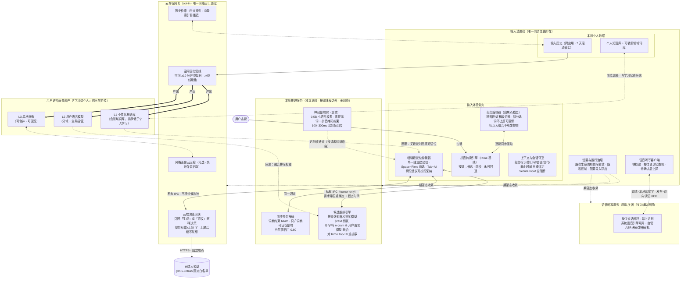
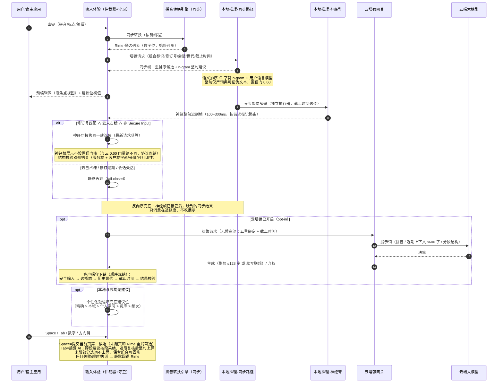
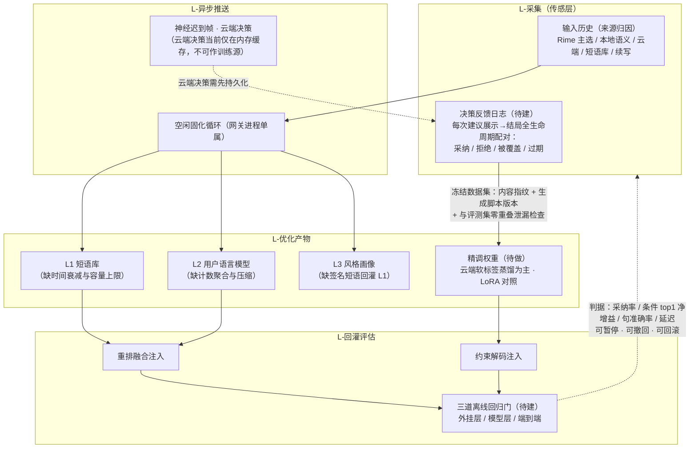
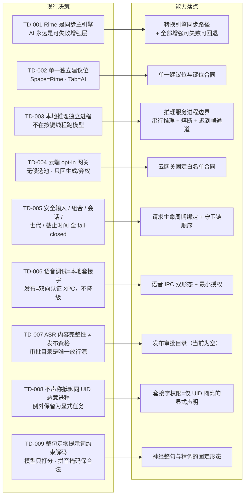
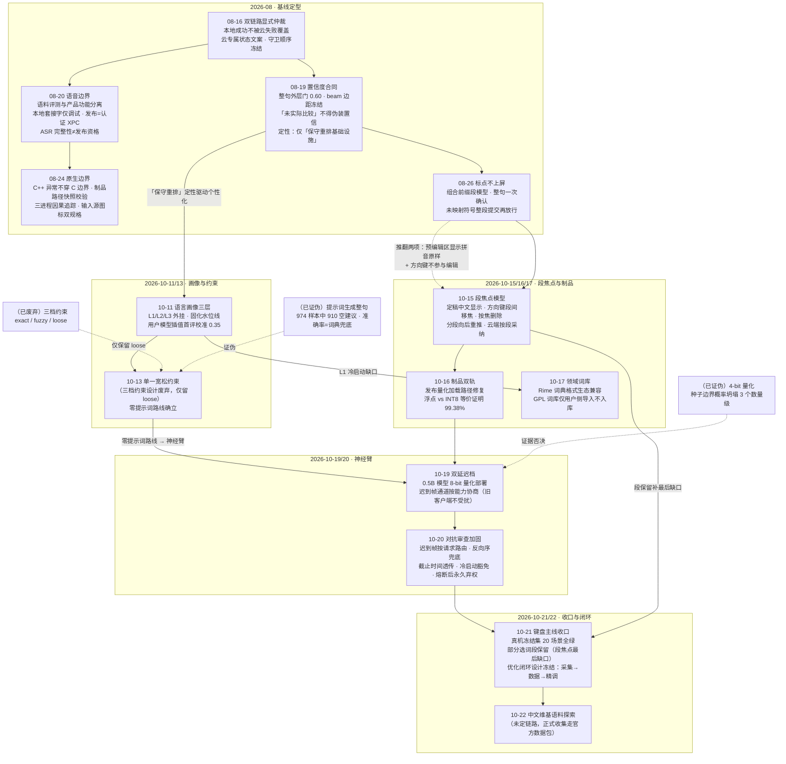

# RimeAI 架构图与决策图（能力视图）

| 项目 | 当前值 |
|---|---|
| 版本 | 2.0 |
| 更新日期 | 2026-10-22 |
| 快照基线 | 键盘主线收口、双延迟档部署、持续优化闭环设计冻结之后 |
| 事实源 | [TECHNICAL_DESIGN.md](../TECHNICAL_DESIGN.md) · [TASKS.md](../TASKS.md) · [CONTINUOUS_OPTIMIZATION_LOOP_DESIGN.md](CONTINUOUS_OPTIMIZATION_LOOP_DESIGN.md) |

> 本文是面向技术人员的**能力级逻辑架构**视图：构件=能力，不含类/文件/协议字段名。与上述文档冲突时以文档为准。产品状态 `NOT RELEASED`。

## 1. 能力架构总图（进程边界 · 能力分组 · 数据流 · 信任边界）

信任边界与不变式：

- **唯一同步主链**：拼音转换引擎在按键线程同步完成；重排、整句、神经臂、云端、语音全部可失败/取消/未安装，纯 Rime 输入不受影响。
- **三条 IPC + 一条 HTTPS**：输入法↔本地推理、输入法↔云网关均为 owner-only 套接字（仅隔离其他系统用户，不防同 UID 恶意进程——显式不设防）；唯一网络出口在云网关，且只访问冻结白名单端点与模型。
- **云端最小授权**：请求不携带候选池；云端只做「生成/弃权」决策，不能指定上屏文本之外的内容；采纳必须用户显式确认。
- **Secure Input = 熔断**：阻断云请求、历史写入、在途采纳与反馈采集。
- **推理制品双轨**：开发环境浮点模型 + 神经臂；发布制品 INT8 量化（冻结集等价证明：top-1 一致率 99.38%）；发布打包尚未含神经臂依赖。

## 2. 一次击键的能力流：双延迟档与建议位仲裁

能力流要点：

- **双延迟档**：同步档（重排 + n-gram 整句，随响应即达）先占建议位；神经档（小模型约束解码）迟到帧按最新请求获胜接管同一建议位；两档互不阻塞。
- **多段（跨标点）请求暂不走神经臂**，由同步整句 + 分段机制服务：焦点段定稿后自动向后重推后缀段，云端整句可按段采纳、用户逐段复核。
- **续写联想**是云端第二条决策路由：上屏后给出接续建议，Tab 接受、8s 自动隐藏、击键/切会话即撤销。
- **无空格中英混输**走本地保守分段：连续大写=强英文边界；全小写只认保守技术词/个人词，Tab 显式采用；Space 永远提交 Rime 首选。

## 3. 持续优化闭环（2026-10-21 冻结设计）

冻结决策（D1–D7 摘要）：采集本地优先（默认零上传）；反馈最小单元=（输入，候选，采纳结果）三元组；训练数据可复现（内容指纹绑定）；云端只当教师出软标签、其生成文本不作金标；权重更新离线+显式+可灰度；**个性化优先落外挂层、不进权重**；一切产物可单独撤回并保留上一版。

任务链：**反馈采集（LM-003）→ 蒸馏数据管道（LM-004）→ 约束解码精调（LM-002）**——当前最高优先级；采集日志的进程归属（推理服务内置 vs 云网关旁挂）须实现前钉死。

## 4. 架构决策图

### 4.1 现行技术决策（TD-001~009）→ 能力落点映射

### 4.2 决策演进时间线（含推翻 / 证伪链）

演进主线一页读法：

1. **可靠性骨架先行**（08 月）：主链仲裁、置信度合同、语音与原生安全边界全部在增强功能之前定型。
2. **两轮模型路线证伪**：提示词生成整句（10-13）与 4-bit 量化（10-19）都用冻结集证据否决，而非讨论；零提示词约束解码由此成为神经整句与精调的固定形态。
3. **一次交互范式推翻**：08-26「标点不上屏」组合模型在 10-15 被段焦点模型部分推翻（预编辑区显示与方向键合同各推翻一项）；10-21 部分选词段保留补齐该模型最后缺口后，键盘主线全部内部收口。
4. **当前重心**从键盘交互转到持续优化闭环：先补传感层（决策反馈日志）与数据管道（冻结数据集），才允许启动权重更新（软标签蒸馏精调；放行门=句准确率 +2pp 且「模型路径选错」错误桶降 ≥50%）。
5. **发布仍是显式 blocker**：公证/清洁机/宿主矩阵与真实凭据/目标网络/费用矩阵两组发布门保持阻塞，内部收口不等于可发布。
